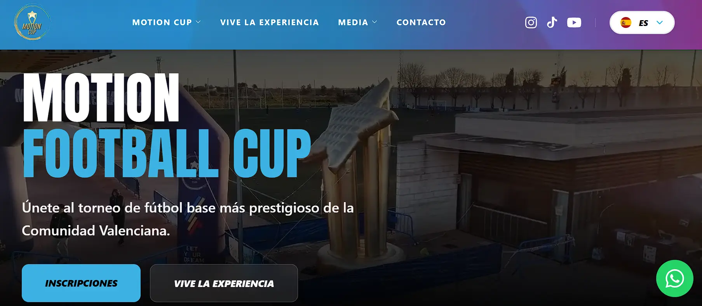
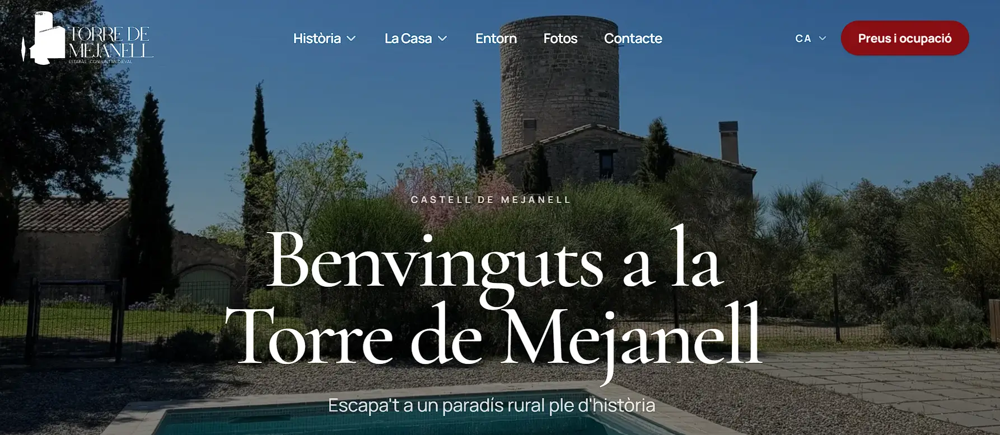

# De isla en isla

Portfolio personal de Iker Benítez: un recorrido desde Menorca por el
aprendizaje, proyectos, viajes y las pequeñas cosas que me ayudan a seguir.

## Stack

Next.js App Router, React, TypeScript, Tailwind CSS, Framer Motion,
react-simple-maps y Resend para el formulario de contacto.

## Capturas

Las siguientes capturas pertenecen a proyectos del portfolio; las imágenes de
las tarjetas y viajes siguen siendo provisionales y deben sustituirse.

## Desarrollo

Instala las dependencias con `npm install` y ejecuta `npm run dev`. Abre
`http://localhost:3000` para ver el portfolio. Para comprobar la versión de
producción, ejecuta `npm run build`.

Los textos del Hero y los hitos de «Mi recorrido» están en `data/timeline.ts`.
La ruta y las entradas se adaptan a la preferencia de movimiento reducido del
sistema.

Los textos del primer proyecto están en `data/firstYes.ts`. Para mostrar los
importes, cambia `amounts.show` a `true`; también puedes omitir `amounts`.
Los proyectos se editan en `data/projects.ts`: sus enlaces `demo` y `repo` son
opcionales. Las imágenes de `public/projects/` son provisionales y están
marcadas con TODO para sustituirlas por capturas reales.

Los lugares del mapa están en `data/trips.ts`. Sus coordenadas siguen el orden
`[longitud, latitud]`; añade fechas, anécdotas y fotografías propias cuando
estén disponibles. La imagen de `public/travel/` es provisional. El mapa se
carga al acercarse a la sección y ofrece una vista de lista accesible; la
cartografía se incluye localmente mediante `world-atlas`.

## Postal mensual de movimiento

1. Guarda o captura el resumen mensual desde Strava y Hevy. Revisa antes de
   publicarlo la privacidad de los mapas, rutas y cualquier dato personal visible.
2. Convierte cada imagen a WebP con tu editor habitual o, si tienes `cwebp`,
   ejecuta `cwebp -q 85 entrada.png -o strava.webp` (y lo mismo para Hevy).
3. Coloca los archivos en `public/movement/AAAA-MM/strava.webp` y
   `public/movement/AAAA-MM/hevy.webp`. Las imágenes existentes de octubre de
   2026 se reutilizan desde `public/images/training/` sin moverlas.
4. Añade el mes al principio de `months` en `data/movement.ts`: solo se muestra
   el primero. Incluye su etiqueta, rutas y textos `alt` con las cifras. Omite
   `strava` o `hevy` si no hay imagen y añade `note` solo si quieres una nota.
5. Completa los usuarios, enlaces y rutas a los logos originales en
   `profiles`. Los enlaces y logos se muestran únicamente cuando están
   configurados. Revisa las guías de marca oficiales antes de publicar los logos.

## Ahora mismo y contacto

Edita `data/now.ts` para actualizar la fecha, los cuatro bloques y las entradas
del diario, de la más reciente a la más antigua. Las notas iniciales son
ejemplos. Los perfiles sociales están en `data/social.ts`; completa las URLs
de GitHub e Instagram antes de publicarlas.

El formulario utiliza Resend desde el servidor y no necesita SDK. Copia
`.env.example` a `.env.local` y configura:

- `RESEND_API_KEY`: clave privada de Resend.
- `CONTACT_FROM`: remitente de un dominio verificado en Resend.
- `CONTACT_TO`: dirección donde quieres recibir los mensajes.

Reinicia el servidor tras cambiar las variables. No publiques `.env.local`.
Sin esta configuración, el formulario muestra un error y no simula un envío.
Para probar el envío real, configura Resend y manda un mensaje desde el
formulario; comprueba la bandeja del destinatario y la carpeta de spam.
